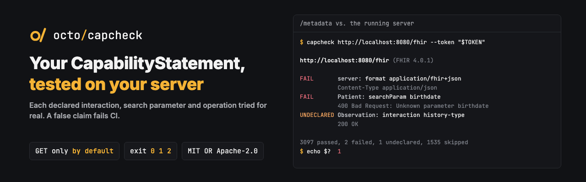

<p align="center"></p>

<p align="center"><b>Does your FHIR server do what its CapabilityStatement says?</b></p>

<p align="center">
  <a href="https://github.com/octofhir/capcheck/actions/workflows/ci.yml"></a>
  <a href="https://crates.io/crates/capcheck"></a>
  <a href="https://docs.rs/capcheck"></a>
  <a href="#license"></a>
</p>

A CapabilityStatement is a set of claims, and nothing checks them. capcheck reads
`/metadata` and puts each claim to the test against the running server: a declared interaction
has to work, a declared search parameter has to be known to the search, a declared operation has
to be there. What works without being declared is reported too.

```sh
capcheck https://fhir.example.org/fhir --token "$TOKEN"
capcheck http://localhost:8080/fhir --write --format markdown > capcheck.md
```

```text
http://localhost:8080/fhir (FHIR 4.0.1)
FAIL       server: format application/fhir+json: Content-Type application/json
FAIL       Patient: searchParam birthdate: 400 Bad Request: Unknown parameter birthdate
UNDECLARED Observation: interaction history-type: 200 OK
3097 passed, 2 failed, 1 undeclared, 1535 skipped
```

The exit code makes it a CI gate: 0 when the claims hold, 1 when one does not, 2 when no run was
possible. `--fail-on undeclared` also fails on undeclared behavior, and `--fail-on never` only
reports.

## What is checked

| Claim | How |
|---|---|
| `format` | `/metadata` answers `application/fhir+json`; errors are OperationOutcomes |
| `rest.interaction` | `search-system` and `history-system` give a Bundle of the right type |
| `rest.resource.interaction` | `search-type`, `history-type`, and on a stored resource `read`, `vread`, `history-instance` |
| `versioning` | Reads carry an ETag with the version |
| `conditionalRead` | `If-None-Match` and `If-Modified-Since` give 304 |
| `searchParam` | A search with a value of the declared type is accepted. With `Prefer: handling=strict` the parameter must not be refused, and the server is first checked to refuse an unknown one. Without strict handling, the parameter has to be in the `self` link; a result with no `self` link says nothing either way |
| `searchInclude`, `searchRevInclude` | The same, as `_include` and `_revinclude` |
| `operation` | Operations that change nothing are called with a GET; they may refuse to work without parameters, but they have to be there, at type or instance level. `rest.operation` may also hold operations of several resource types, so a miss at system level only fails when the OperationDefinition has `system = true` |

With `--write`, on Patient: `create`, `update`, `patch`, `delete`, `conditionalCreate`,
`conditionalUpdate`, `conditionalDelete`, and that `versioned-update` refuses a stale `If-Match`.
This creates and deletes resources, marked with the identifier system `urn:capcheck`. Do not run it
against production.

## What a verdict means

| Verdict | Meaning |
|---|---|
| `FAIL` | The statement claims something the server does not do |
| `UNDECLARED` | The server does something the statement does not claim |
| `SKIP` | The claim could not be put to the test: no stored resource to read, no safe way to call an operation, a search parameter of type `composite` or `special`, or no rights (401, 403) |

A run without `--write` only sends GET requests. An operation is called only if the specification
or its OperationDefinition says it changes nothing.

## Options

| Option | Meaning |
|---|---|
| `--token` | A bearer token, or `CAPCHECK_TOKEN` |
| `--type` | Only this resource type; can be repeated |
| `--concurrency` | Requests under way at the same time, 8 by default |
| `--write` | Also check writes on Patient |
| `--format` | `text`, `markdown` or `json` |
| `--fail-on` | `fail`, `undeclared` or `never` |
| `--verbose` | List what was skipped too |

## As a library

```rust,no_run
# async fn run() -> Result<(), capcheck::Error> {
let report = capcheck::check(&capcheck::Options::new("https://fhir.example.org/fhir")).await?;
println!("{}", report.markdown());
# Ok(())
# }
```

## License

MIT or Apache-2.0, at your option.
